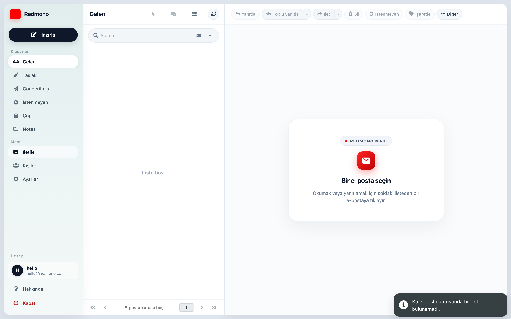
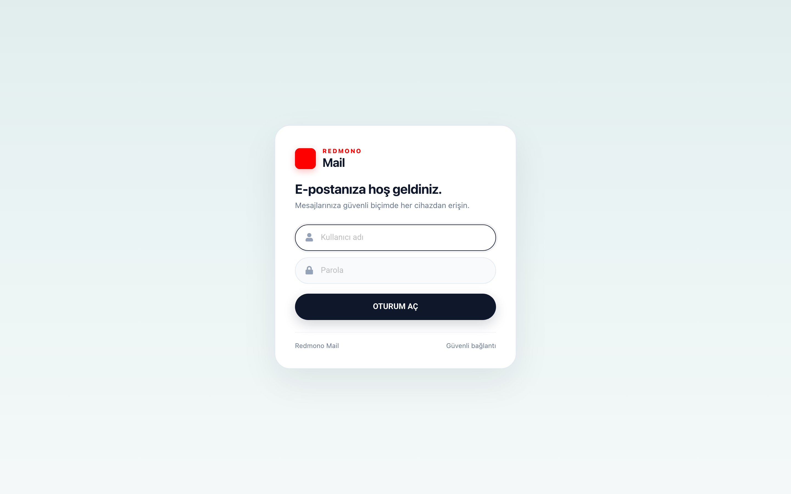
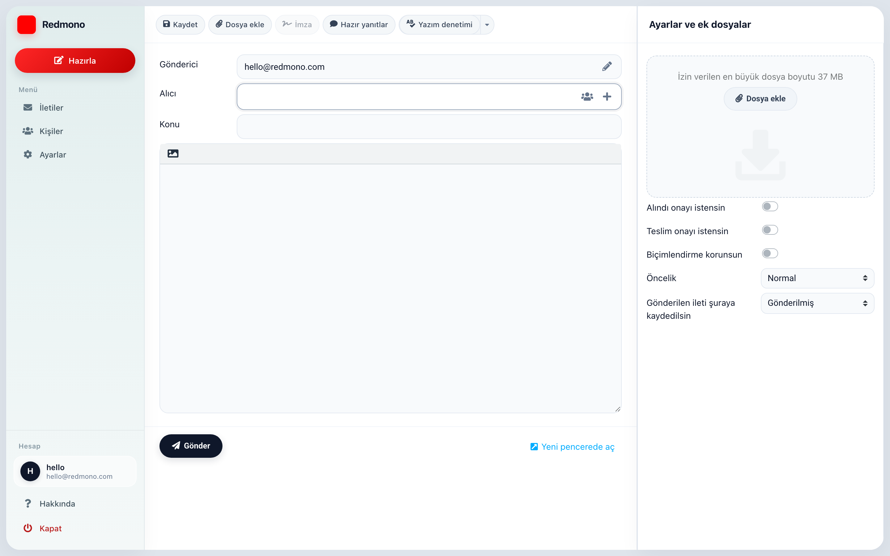
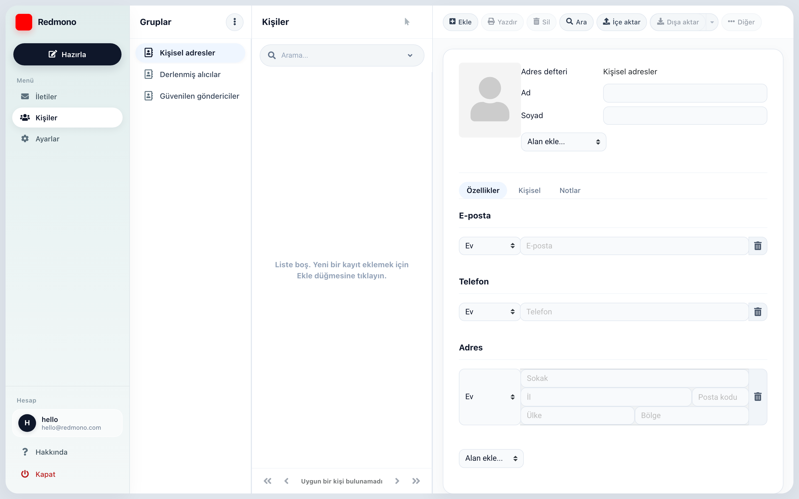
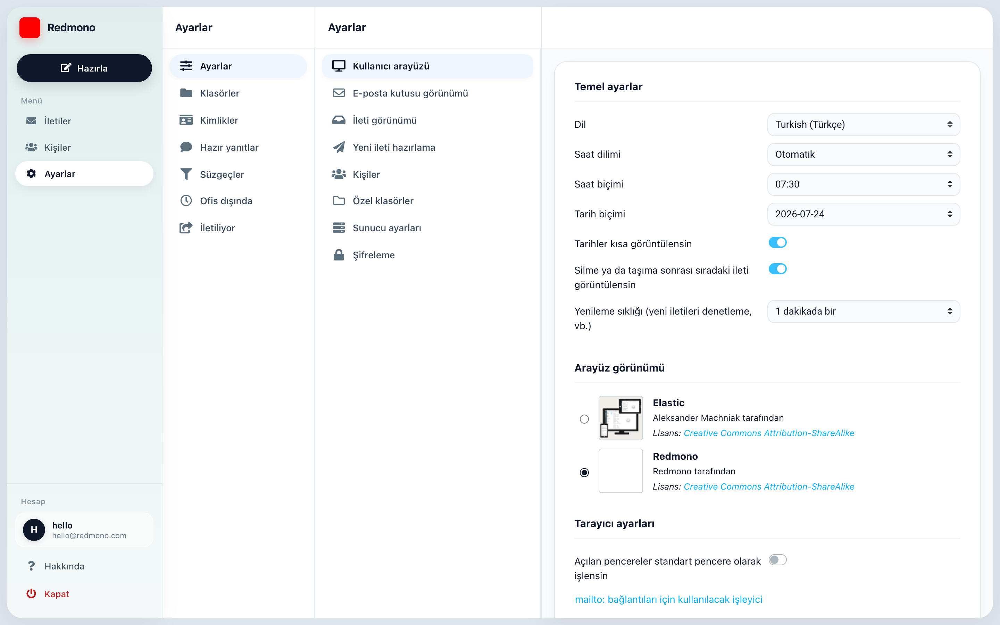
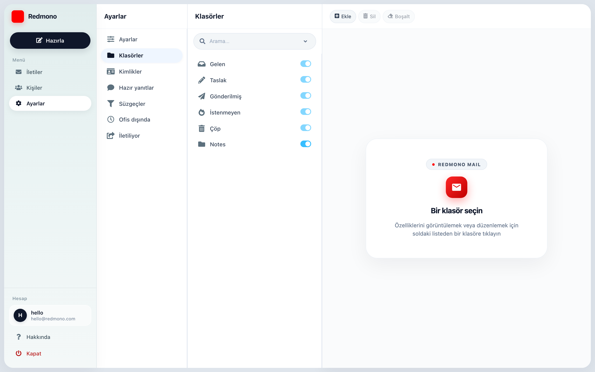
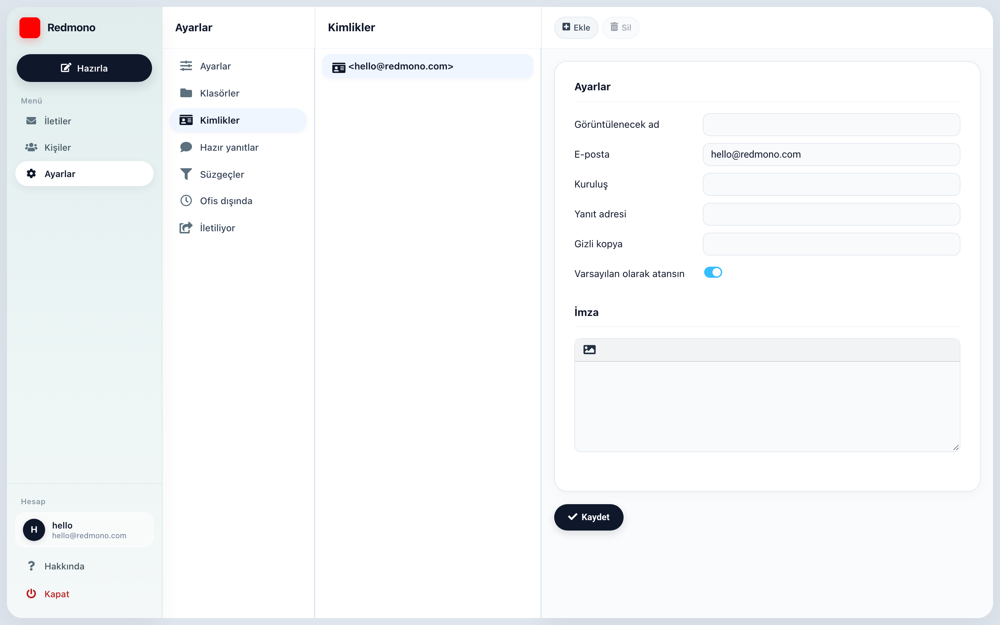
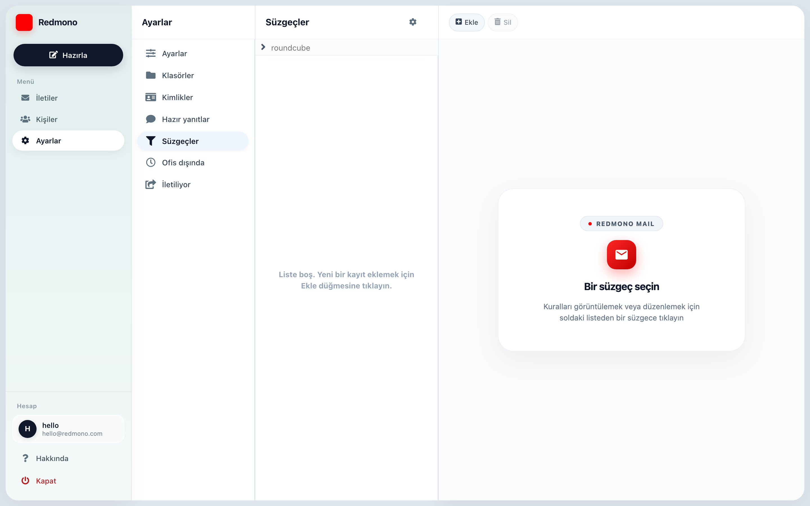
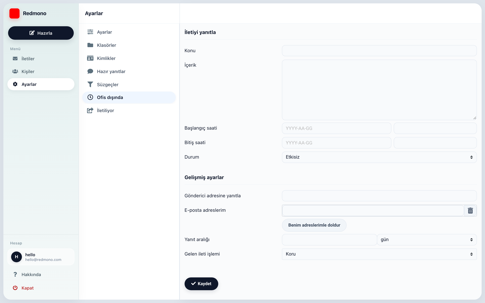

# DAAK-Redmono Mail UI

> A modern, calm, soft-sage floating workspace skin for **Roundcube Webmail** — built by extending Roundcube's official `elastic` foundation with crisp geometry, optical alignment, and full internal-page parity.



---

## Why DAAK-Redmono Mail UI?

Traditional webmail themes often feel visually heavy or leave Settings, Filters, Contacts, and Compose lagging behind the main inbox. **DAAK-Redmono Mail UI** brings a cohesive studio-grade SaaS workspace aesthetic directly to Roundcube **without breaking plugins, accessibility, or upgrades**:

- **Pure Child Skin (`"extends": "elastic"`)**: Inherits 100% of Roundcube Elastic's templates, keyboard navigation, responsive hooks, Bootstrap 4 grid, and third-party plugins (ManageSieve, Password, Enigma, etc.). Only the layout shell, menu, login card, watermark, styles, and enhancement script are overridden.
- **Soft-Sage Floating Canvas**: A serene sage-tinted outer frame (`#e3ebe9` → `#edf3f1`) holds a dedicated `224px` navigation rail and an elevated rounded white workspace (`border-radius: 26px`).
- **Optical Alignment & Zero-Wrap Toolbars**: Top header actions, icon+label alignments, search pills (`border-radius: 999px`), and active selection pills (`#ffffff` elevated cards / crisp black badges) are calibrated to eliminate jitter across viewports.
- **Unified Internal Page Parity**: Consistent visual rhythm across **Login**, **Inbox**, **Compose**, **Contacts**, **Preferences**, **Folders**, **Identities**, **Filters**, and **Vacation (Out-of-Office)**.
- **Live Docked Folder Navigation**: Automatically docks mailbox folders smoothly inside the sidebar under the Primary CTA (`New message` / `Compose`) with live badge counters.
- **Locale-Friendly & White-Label Ready**: Uses `<roundcube:object name="productname" />`, `<roundcube:object name="logo" />`, and `<roundcube:label />` tags so your own Roundcube server name, custom `skin_logo`, and user language (`EN`, `TR`, etc.) work out of the box.

---

## Visual Tour

### Login & Inbox

| Sign-In Portal | Inbox & Message Workspace |
| :---: | :---: |
|  |  |

### Compose & Contacts

| Compose Editor | Address Book & Contact Form |
| :---: | :---: |
|  |  |

### Settings & ManageSieve Suite

| Preferences | Folders Manager | Identities |
| :---: | :---: | :---: |
|  |  |  |

| Message Filters (ManageSieve) | Vacation / Auto-Responder |
| :---: | :---: |
|  |  |

---

## Structure

```text
skins/daak-redmono/
├── meta.json                      # Declares "extends": "elastic" & light canvas config
├── thumbnail.png                  # 64×64 skin preview thumbnail for Roundcube Settings
├── watermark.html                 # Floating empty-state card inside preview frames
├── README.md
├── images/
│   ├── redmono-mark.svg           # Default crisp #ff0000 square mark + monogram
│   ├── favicon.svg
│   └── logo*.svg                  # Dark / small logo variants
├── scripts/
│   └── theme.js                   # Folder docking, account badge sync, frame state hints
├── styles/
│   └── styles.css                 # Extends ../../elastic/styles/styles.min.css
└── templates/
    ├── login.html                 # Centered clean single-card sign-in portal
    └── includes/
        ├── layout.html            # Head assets + versioned stylesheet/script hooks
        └── menu.html              # Sidebar brand header, compose CTA, folders, apps, account
```

---

## Installation

### Option 1: Docker / Docker Compose (Recommended)

Mount `skins/daak-redmono` directly into your Roundcube container's skins directory:

```yaml
services:
  roundcube:
    image: roundcube/roundcubemail:latest
    volumes:
      - ./skins/daak-redmono:/var/www/html/skins/daak-redmono:ro
```

Then enable the skin in `config/config.inc.php`:

```php
$config['skin'] = 'daak-redmono';
```

### Option 2: Manual Installation

```bash
git clone https://github.com/benfirad/daak-redmono-mail-ui.git
cp -R daak-redmono-mail-ui/skins/daak-redmono /path/to/roundcube/skins/daak-redmono
```

Set `$config['skin'] = 'daak-redmono';` in `/path/to/roundcube/config/config.inc.php`.

### Custom Branding (`$config['skin_logo']`)

You can override the square `#ff0000` mark at runtime without modifying skin files by setting standard Roundcube config:

```php
$config['product_name'] = 'Your Mail';
$config['skin_logo'] = '/path/to/your-logo.svg';
```

---

## Requirements & Compatibility

- **Roundcube Webmail**: `1.6.x` or `master` (requires `elastic` core skin present in `skins/elastic`)
- **Browsers**: Tested across Chromium, Safari/WebKit, and Firefox
- **Plugins**: Compatible with standard bundled plugins (`managesieve`, `password`, `markasjunk`, `archive`, `zipdownload`, `emoticons`, etc.)

---

## License

- **DAAK-Redmono Mail UI**: [GPL-3.0-or-later](https://www.gnu.org/licenses/gpl-3.0.html) — Firat Dasdogen ([DAAK](https://github.com/benfirad) / Redmono)
- **Foundation**: Extends Roundcube's `elastic` skin by Aleksander Machniak (`CC-BY-SA-3.0`).
